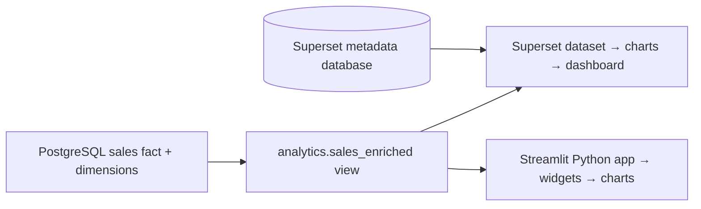

# Practice 11: tell a data story with Superset and Streamlit

**Week 7 · 20 October 2026 · 2 hours**

In this practice you will turn a small PostgreSQL dataset into two views of the same business question. In **Apache Superset**, you will connect to a database, explore it with SQL Lab, and build a dashboard by using the browser. In **Streamlit**, you will use and slightly adapt a ready-made Python dashboard. The purpose is to learn what each tool offers and how it connects to data. You do not need to write a Docker configuration, a pipeline, or a Python application from scratch.

> **Question:** Which product categories and regions deserve attention in the selected sales period?

The data is fictional. The measure **gross sales** means `SUM(sales_amount)` in euros. It says how much was sold in this sample; it does **not** show profit, margin, real customer demand, or the number of orders. One data row is a synthetic daily observation for one region and category.

## Learning outcomes

By the end, you should be able to:

1. Explain the path from a PostgreSQL table and view to a Superset dataset, chart, and dashboard.
2. Run a read-only query in SQL Lab and define a reusable gross-sales metric.
3. Build and filter a Superset dashboard that answers the question above.
4. Recognize how a Streamlit script gets data, creates a widget, and redraws its charts after a selection changes.
5. Use the same region and category filters in both tools, compare the resulting figure, and explain when you might choose one tool over the other.

**Prerequisites:** the earlier Docker and PostgreSQL practices, basic `SELECT` and `GROUP BY` queries, and the lecture's introduction to data visualization. The supplied configuration and Streamlit starter handle the setup and most of the Python work.

## Session overview — 120 minutes

| Time | Work | Checkpoint |
| --- | --- | --- |
| 0–10 min | Read the question and data path | Define gross sales and the row grain. |
| 10–20 min | Start the environment | Both pages open; 1,104 rows are present. |
| 20–35 min | Connect Superset and use SQL Lab | The total is €16,835.80. |
| 35–60 min | Register the dataset and build three charts | Trend, category comparison, and KPI show data. |
| 60–80 min | Compose and filter a dashboard | Region and category filters change the KPI. |
| 80–105 min | Inspect and adapt Streamlit | Your new category widget filters its charts. |
| 105–115 min | Compare and discuss the tools | South + Household is €2,920.00 in both. |
| 115–120 min | Save your work and stop services | You can restart without losing the Superset dashboard. |

Prepare the workspace and download images **before class** if possible. If a download takes longer than the setup window, begin reading [How the two tools use the data](#how-the-two-tools-use-the-data) while it completes. The optional activities are **outside** the two-hour route.

## Prepare your workspace

You need a running Docker installation with `docker compose`, a browser, and an editor such as VS Code. As in the earlier practices, work in a **separate folder**, outside the course repository. You can obtain the supplied files from a local checkout or a downloaded repository ZIP; you do not need to edit the course copy.

1. Create a folder such as `superset-practice`.
2. Copy these files and folders from `11_Superset` into it, keeping the layout below. The hidden `.env.example` file is needed too.
3. Open a terminal **in your practice folder**, the one containing `compose.yml`. Run every later `docker compose` command there.

```text
superset-practice/
├── compose.yml
├── .env.example
├── .gitignore
├── superset_config.py
├── db/
│   ├── init/01-create-database.sh
│   └── seed/02-seed-sales.sql
├── superset/Dockerfile
└── streamlit/
    ├── Dockerfile
    ├── requirements.txt
    └── app.py
```

The first run downloads a Superset image and a Python image for Streamlit. PostgreSQL uses the same **16.4** image as earlier course practices, so Docker can reuse it if you still have it. If your connection is slow, run these commands in your new practice folder before class:

```bash
docker compose pull db
docker pull apache/superset:6.1.0
docker pull python:3.12-slim
docker compose build
```

The images and built Python packages are reused later. The sample credentials in `.env.example` are for a **private local practice**; keep any forwarded Codespaces ports private.

## How the two tools use the data



The PostgreSQL server has two databases. `viz_practice` holds the fictional sales data. `superset_meta` holds Superset's users, saved connections, charts, and dashboards. They share one server to keep the exercise small, but serve different purposes.

The running stack is PostgreSQL **16.4**, Superset **6.1.0**, and Streamlit **1.64.0**. A short `superset-init` job configures Superset and then exits. The pinned versions help everyone see the same classroom behavior.

The `analytics.sales_enriched` **view** joins a sales fact table to store and product dimensions. It exposes `sale_date`, `region`, `category`, `quantity`, and `sales_amount`. A view is a saved SQL query: both tools can read a clear, consistent serving layer without repeating the joins. The local `viz_reader` account can read the view but cannot change the data.

Superset stores **dataset** definitions, metrics, charts, and dashboards in its metadata database. Its charts query PostgreSQL when viewed or refreshed. Streamlit runs a Python script, queries the same PostgreSQL view, and draws its interface in the browser. Changing a Streamlit widget reruns the script. Neither frontend owns the sales data.

You can inspect the supporting files if you are curious: [`compose.yml`](compose.yml) starts the containers, [`db/seed/02-seed-sales.sql`](db/seed/02-seed-sales.sql) creates the sample, and [`streamlit/app.py`](streamlit/app.py) renders the second dashboard. During the core practice, you will edit **one marked line** in `streamlit/app.py`; the other files are provided.

## Task 1 — start and check the environment

Open a terminal in your practice folder. If you have not created `.env` from `.env.example` yet, do that first. Then start the supplied stack:

```bash
docker compose up -d --build
docker compose ps -a
```

The `--build` option adds Superset's PostgreSQL driver and installs Streamlit's Python packages. On the first run, give the containers a few minutes. A healthy result has `db`, `superset`, and `streamlit` running; **`superset-init` should have exited with code 0**. It is a one-time setup job, not a failed server. Docker also creates `pgdata/` in your practice folder; it holds both the sample and your saved Superset work.

Open the pages:

| Tool | Local address | Login |
| --- | --- | --- |
| Superset | <http://localhost:8088> | `admin` / `admin` from the classroom `.env` |
| Streamlit | <http://localhost:8501> | No login in this local starter app |

In GitHub Codespaces, use the **Ports** tab for ports 8088 and 8501 and keep them **Private**. If you changed `SUPERSET_PORT` or `STREAMLIT_PORT` in `.env`, use those host ports in the browser. Do not use the database service name `db` in your browser; it is a hostname **inside Compose**.

Check the sample without installing `psql` on your computer:

```bash
docker compose exec db psql -U superset -d viz_practice -c \
  "SELECT COUNT(*), MIN(sale_date), MAX(sale_date) FROM analytics.sales_enriched;"
```

PowerShell users can put the command on one line and omit the backslash. Expect **1,104 rows**, with dates **2026-07-01** through **2026-09-30**. If `superset` has not appeared yet, inspect `docker compose logs --tail=40 superset-init`. Continue when the login page works.

## Task 2 — connect Superset and ask a question in SQL Lab

Superset needs a connection to the **analytics** database. The metadata connection used internally by Superset is a different one. In Superset, open **Settings → Database Connections → + Database**, choose **PostgreSQL**, and name the new connection `Supermarket practice`.

If the dialog asks for separate fields, use:

| Field | Value |
| --- | --- |
| Host | `db` |
| Port | `5432` |
| Database | `viz_practice` |
| Username | `viz_reader` |
| Password | `course_reader_2026` (or your `VIZ_READER_PASSWORD` from `.env`) |

If it asks for a SQLAlchemy URI instead, paste this for the unmodified classroom `.env`:

```text
postgresql+psycopg2://viz_reader:course_reader_2026@db:5432/viz_practice
```

Choose **Test Connection**, then save. `db` is the PostgreSQL service name on the Compose network. `localhost` inside Superset would point back to Superset itself. If the database does not appear in SQL Lab, edit its connection and enable **Expose in SQL Lab**.

Open **SQL → SQL Lab**, select `Supermarket practice`, and run:

```sql
-- COUNT tells us how many observation rows exist. MIN and MAX tell us the
-- period covered by the sample. SUM adds the already calculated euro amounts.
SELECT
    COUNT(*) AS observations,
    MIN(sale_date) AS first_date,
    MAX(sale_date) AS last_date,
    ROUND(SUM(sales_amount), 2) AS gross_sales_eur
FROM analytics.sales_enriched;
```

Expected: **1,104 observations**, **2026-07-01 → 2026-09-30**, **€16,835.80**. If SQL Lab's number formatting differs, compare the digits. Next, ask which combinations contribute most:

```sql
-- GROUP BY makes one result row for each region/category combination.
-- SUM then adds only the observations in that group.
SELECT region, category, ROUND(SUM(sales_amount), 2) AS gross_sales_eur
FROM analytics.sales_enriched
GROUP BY region, category
ORDER BY gross_sales_eur DESC;
```

Notice that South + Household is first. SQL Lab is useful for checking a claim before choosing a chart; it is not itself the audience-facing dashboard.

## Task 3 — make a reusable dataset and three charts

In Superset, a **dataset** points to a table or view and describes fields and metrics that charts can reuse. Go to **Datasets → + Dataset** (in some layouts, **Data → Datasets → + Dataset**). Select the `Supermarket practice` connection, schema `analytics`, and table/view `sales_enriched`. Create the dataset.

Open the dataset's **Edit** page, select the **Metrics** tab, and add a metric with these values (expand the row for the SQL expression):

| Setting | Value |
| --- | --- |
| Metric key | `gross_sales_eur` |
| Label | `Gross sales (EUR)` |
| SQL expression | `SUM(sales_amount)` |

Defining the metric at dataset level lets several charts reuse the same formula. In the chart exercises below, select this saved metric, labeled **Gross sales (EUR)**. A metric is an aggregate; `sale_date`, `region`, and `category` are dimensions used to group or filter it.

Build these charts from **Charts → + Chart**. Use the `sales_enriched` dataset each time. Superset may call the time field **Time Column** or **X-axis**, depending on the chart editor layout.

| Chart to save | Visualization | Main fields | Question it answers |
| --- | --- | --- | --- |
| `Daily gross sales` | Line Chart | Time: `sale_date`; Time grain: Day; Metric: `Gross sales (EUR)` | How does the amount vary by day? |
| `Gross sales by category` | Bar Chart | X-axis: `category`; Metric: `Gross sales (EUR)`; sort descending if available | Which category contributes most? |
| `Total gross sales` | Big Number | Metric: `Gross sales (EUR)` | What is the total for the current selection? |

For each chart, choose **Time range: No filter** or **All time** if the control appears, click **Run / Update Chart**, then **Save**. This is historical sample data; a default recent time range can produce a blank chart. Add `EUR` or `€` to titles and axis labels. In the Big Number's **Customize** panel, turn off compact notation or choose a two-decimal number format if you want to compare its exact value with SQL Lab.

Check that the line has many dates, the bar chart has four categories, and the Big Number corresponds to €16,835.80 when no filter is applied. An empty chart usually means a time filter, a missing metric, or the wrong dataset.

## Task 4 — build a dashboard and explain it

Create **Dashboards → + Dashboard**, name it `Supermarket Overview`, and add your three saved charts. You can also choose **Save and add to dashboard** when saving a chart. Put the total above the trend and comparison charts: readers should see the headline number before the detail. Save the layout.

Add two **native filters** in the dashboard editor. Open the **Filter Bar → + Add/Edit Filters** (or the filter icon while editing):

1. Add a filter with type **Value** on `region` from the `sales_enriched` dataset. Name it `Region` and apply it to **all three charts**.
2. Add another filter with type **Value** on `category` from the same dataset. Name it `Category` and apply it to **all three charts**.
3. Save filters and the dashboard. In view mode, choose **South** and **Household**. The total should be **€2,920.00** (perhaps displayed as `2.92k` if compact formatting is on).

Filters should change the KPI, trend, and bar chart together. If one chart stays the same, check the filter's **scope** and whether that chart uses the same dataset. Restore **all regions and categories** before your first general interpretation.

Write two sentences below the dashboard as a **Markdown/text block** if the editor offers one, or in your notes:

> Household has the largest gross sales in this fictional sample. This alone does not show which category is most profitable, because costs and margins are absent.

Use your own wording. A good dashboard tells the reader what a number means and what decision it cannot support. Ask yourself whether a different date range or a different metric would change the story.

## Task 5 — explore the Streamlit starter

Open Streamlit at <http://localhost:8501>. Select just **South** in the sidebar and observe the KPI, line, and bar chart. Open **Show the rows behind these charts** to see the records that were plotted. Clear the region selection: the app gives a useful message rather than drawing an empty chart.

In your editor, open [`streamlit/app.py`](streamlit/app.py). Read the commented sections in this order:

1. `load_sales()` queries the same `analytics.sales_enriched` view. `@st.cache_data(ttl=60)` avoids running the SQL on every small interaction for one minute.
2. `st.sidebar.multiselect` creates the Region widget. A widget returns the current selection.
3. `visible = ...` keeps rows that match the chosen region and category. The KPI and both charts use **those same filtered rows**.
4. `st.metric`, `st.line_chart`, and `st.bar_chart` render the results. Streamlit reruns the script when a widget changes.

The script contains more code than you need to write today. Read the comments and identify the data path; you will change only one marked line in the next task.

## Task 6 — add a category selection to Streamlit

Find the line below `# TASK 6` in [`streamlit/app.py`](streamlit/app.py):

```python
selected_categories = all_categories
```

Replace **that one line** with:

```python
# Show all categories at first; the user can then choose a smaller set.
selected_categories = st.sidebar.multiselect(
    "Categories", all_categories, default=all_categories
)
```

`"Categories"` is the label shown to the user. `all_categories` provides the choices from PostgreSQL. `default=all_categories` begins with every category selected, so the initial total stays comparable with Superset. Save the file. The running Streamlit container sees the edit through a file mount and should rerun the app; if it does not, click **Rerun** in the browser or run `docker compose restart streamlit`.

Choose **South** and **Household** in Streamlit. Check that its gross-sales KPI is **€2,920.00**. Clear either selection and notice the empty-selection message. Restore the selections. You have added an interaction without rewriting the SQL query or charts: the existing `visible` selection already controls them all.

## Task 7 — compare, choose, and share

Keep South + Household selected in both tools, and verify the **€2,920.00** figure. If the figures differ, check the date range, both filters, and which metric each tool is adding. Superset and Streamlit are linked to **the same data view**, but they maintain their own filter state; choosing a filter in one does not automatically change the other.

| Question | Superset | Streamlit |
| --- | --- | --- |
| How do you make a chart? | Configure a dataset and visualization in the browser. Little code is needed for standard BI charts. | Write or adapt Python that queries data and draws the interface. |
| What is easy? | SQL exploration, reusable metrics, dashboard assembly and shared BI navigation. | Custom interactions, Python calculations, and a tailored app flow. |
| What takes work? | Server setup, data permissions, and unusual interactions outside built-in chart/filter options. | Code, dependencies, tests, hosting, and access control for a shared app. |
| Best fit here | A repeatable sales overview for analysts or managers. | A purpose-built tool whose inputs and output guide a particular decision. |

There is no universal winner. For a project, choose based on the audience, desired interaction, available development time, and how you will manage data access. In one or two sentences, say which you would use for your group project and why.

Copy the **Superset dashboard URL** from the browser if you want to return to it. The Streamlit address is the local app's URL. These `localhost` links work only on your own computer while the services run; sharing a dashboard with someone else needs a hosted service and suitable access controls. The [weather example project](https://github.com/KristoR/ut-andmeinseneeria-2026/tree/main/projekt/naidisprojekt-ilmaandmed) (in Estonian) shows a larger Streamlit app connected to a PostgreSQL mart.

If time permits, make a portable copy of your Superset work: open the **Dashboards** list, select your dashboard, and use its **Export** action to download a ZIP file. In another Superset instance, the **Import** action can restore the dashboard together with its related charts, datasets, and database connection definition. You still need the underlying PostgreSQL data and a working connection to it: on a different machine, the imported `db` hostname or credentials may need updating before charts load. Keep the ZIP as a dashboard backup, and keep the database data separately. Treat the ZIP as private because connection settings can be included. See [Superset's dashboard import/export API](https://superset.apache.org/developer-docs/6.1.0/api/dashboards/) and [connection export notes](https://superset.apache.org/admin-docs/6.1.0/configuration/importing-exporting-datasources/) for the details.

## Finish and restart later

Your completed work consists of a saved Superset dashboard, a working Streamlit category filter, the cross-tool figure check, and a short interpretation. Stop the services from your practice folder:

```bash
docker compose down
```

Your Superset work is saved under `pgdata/` in your practice folder. Return later with `docker compose up -d`; the database seed is created only on the **first** run with an empty `pgdata/` folder. Changes to seed SQL or initial database passwords do not rewrite an existing database. To start with a fresh database, stop the stack and rename `pgdata/` to `pgdata-backup/` (or another unused name), then run `docker compose up -d --build` again. You can rename it in a file manager, or use `mv pgdata pgdata-backup` in Bash and `Rename-Item pgdata pgdata-backup` in PowerShell. Renaming that folder also moves your saved dashboards and sample data. `docker compose down -v` does **not** erase a bind-mounted `pgdata/` folder.

### If something does not work

| Symptom | Check |
| --- | --- |
| `docker compose` is unavailable | Start Docker Desktop or your Docker engine; check `docker compose version`. |
| Port 8088 or 8501 is already used | Change `SUPERSET_PORT` or `STREAMLIT_PORT` in `.env`, restart Compose, and open the new host port. |
| Superset login is not ready | Run `docker compose ps -a` and `docker compose logs --tail=50 superset-init`. Wait for init to exit 0. |
| PostgreSQL test fails in Superset | Use host `db`, database `viz_practice`, reader credentials from `.env`, and port `5432` **inside** Compose. |
| Chart has no rows | Set its time range to **No filter / All time**. The sample ends on 30 September 2026. |
| A dashboard filter affects only one chart | Reopen its filter configuration and scope it to all three charts on `sales_enriched`. |
| Streamlit has old content after saving | Click **Rerun** or run `docker compose restart streamlit`. The database result cache expires after 60 seconds. |
| Seed still looks old after editing SQL | The existing `pgdata/` database is reused. Stop Compose and move that folder aside before a fresh start, preserving any work you need. |

## After class: optional directions

- Try a **virtual dataset** in Superset by saving a read-only SQL Lab query. Compare its grain with `sales_enriched`; do not sum an already aggregated result twice.
- Replace the practice view with a read-only connection to your project's PostgreSQL mart. The [advanced Superset example](https://github.com/KristoR/ut-andmeinseneeria-2026/tree/main/09-arianalyytika-ja-serveerimine/edasijoudnud) (in Estonian) shows a larger dbt-to-mart path. The [base example](https://github.com/KristoR/ut-andmeinseneeria-2026/tree/main/09-arianalyytika-ja-serveerimine/baastase) (in Estonian) gives further dashboard storytelling tasks.
- If your project uses ClickHouse, use its [Superset connection guide](https://clickhouse.com/docs/integrations/superset) after the core exercise. The ClickHouse lesson is a legacy resource this year, so it is not needed for this practice.

For more detail on the tools, see the official [Superset dashboard guide](https://superset.apache.org/user-docs/using-superset/creating-your-first-dashboard/) and [Streamlit installation and run guide](https://docs.streamlit.io/get-started/installation/command-line).
